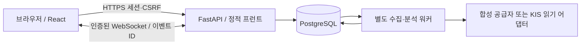

# 설계와 구현 상태

개인 소유자 1명, 미국 NYSE/Nasdaq 보통주 현금 매수, 2~20거래일을 기준으로 한다. ETF·다른 국가·초단타·신용·공매도·파생·추가 매수·자동 손절/매도는 지원하지 않는다.

- **Web**: 로그인·Origin/CSRF, 개인설정, 추천 스냅샷, 주문 의도 영속 저장, 상태 조회/전달. 정적 번들 포함 단일 공개 오리진이다. 공개 회원가입/공개 포트폴리오/공개 데모 API가 없다.
- **Worker**: 브라우저/요청 수명과 무관하게 수집, 부분체결 시뮬레이션, 분석 및 백테스트 작업을 수행한다. PostgreSQL advisory lock으로 collector 1개를 유지한다. DB 연결 손실 시 재연결한다. SIGTERM에서 루프를 종료한다.
- **DB**: 현금·예약금·주문·체결·포지션·원래 기준·분석·알림·세션·heartbeat의 유일한 진실 원천이다. SQLite나 컨테이너 임시 파일에 의존하지 않는다. Alembic의 초기 마이그레이션을 제공한다.
- **분석**: 데이터 정제/검증 → 지표 → 시장·업종 상대강도 → 규칙 후보 → 위험/수량. 뉴스는 별도 출처 정리 모듈이며 임의 가산점이나 LLM 생성 가격/확률을 쓰지 않는다.
- **실제 주문**: 인터페이스와 거부 게이트만 구현되어 있다. 실제 주문 전송·취소·체결통보·외부 거래 대사는 미구현이다. 테스트된 모의 복구 로직을 실증권사 복구 검증으로 광고하지 않는다.

## 주문과 복구의 불변 조건

1. 계좌를 먼저 잠그고 수량/현금/대기 주문/집중도를 검사한다. 같은 UUID 주문 키와 같은 요청은 같은 주문을 반환한다. 다른 내용으로 재사용하면 거절한다.
2. 주문은 커밋 후에만 워커가 볼 수 있다. 클릭 시점 가격은 별도 기록하며 체결가로 간주하지 않는다. 새로운 호가가 없으면 접수/미체결 상태다.
3. 합성 호가 + 편도 5bp 슬리피지가 지정가를 만족할 때만, 틱당 최대 3주를 체결한다. 체결 고유키 `order_id:quote_sequence`로 중복을 막는다. 체결 수량만 포지션/현금에 반영한다.
4. 최초 부분체결 때 보유 만료·최초 목표/손절·환율·추천 근거를 고정한다. 체결 평균가와 비용/계획·스트레스 위험을 갱신한다. 만료를 연장하거나 손절을 낮추지 않는다.
5. 취소와 체결은 같은 계좌 잠금 규칙을 따른다. 취소된 잔량은 후속 이벤트로 체결되지 않는다. 미확정 외부 주문 상태 `needs_review`는 자동 체결/취소/재전송하지 않는 복구 primitive다. 실제 대사는 연결되어 있지 않다.
6. 작업은 PostgreSQL `FOR UPDATE SKIP LOCKED`로 선점하고 60초 lease를 보존한다. 재시작 후 만료 lease만 복구한다. 작업 세대/완료 여부를 재확인하며 분석은 주문을 실행하지 않는다.
7. 호가는 이벤트 시각과 sequence가 역행하면 버린다. 재연결 후 DB 최신 snapshot과 마지막 event ID부터 화면 상태를 복원한다. 워커 공백은 알림으로 남긴다. 실제 스트림의 누락 이력 보충은 공급자가 미연결이므로 미지원이다.
8. 분석 결과는 포지션 버전·가격 변화·유효기간으로 오래됨을 표시한다. 완성 일봉을 재계산하고 시장·업종, 최초/이전 분석과 비교한다. 뉴스/공시/분봉은 분석한 것으로 표시하지 않는다.

## 인증과 운영 경계

Argon2id 비밀번호, 8시간 opaque 세션을 사용한다. DB에는 HMAC 세션 해시만 저장하며 로그아웃은 즉시 폐기한다. 쿠키는 Secure/HttpOnly/SameSite=Strict다. 상태 변경은 정확한 Origin과 세션 CSRF를 모두 검사한다. 로그인도 Origin을 검사하며 계정 전체에 15분당 실패 5회 제한을 둔다. WebSocket은 쿠키/Origin을 확인하고 연결 중에도 만료를 재확인한다. XSS 완화를 위해 CSP·프레임 차단·nosniff를 적용하고 뉴스 HTML을 렌더링하지 않는다.

`.env`와 API 키를 번들·localStorage·Git에 저장하지 않는다. 로컬 HTTP 개발에서만 Secure를 해제할 수 있다. 공개 `/healthz`는 DB 접속을 포함한 최소 상태만 반환하며 상세 워커/API 상태는 로그인 뒤에 보인다. 모의 포트폴리오를 실계좌로 간주하지 않으며, `DATA_MODE` 변경 전 별도 DB를 사용해야 한다.

## 구현 순서와 완료 범위

A 공식 샘플/환경 조사 → B UI·계산·데모 → C 읽기 어댑터·오류 처리 → D 영속 모의 주문·분석 → E 사용자 매도·복구 → F 가격 백테스트·테스트 → G 인증·PostgreSQL·Render 파일 → H 실제 브라우저 검증을 수행한다.

완성된 코드의 기능과 미연결 범위는 [데이터 표](DATA_SOURCES.md), [검증 기록](VALIDATION.md)을 기준으로 판단한다. 실제 뉴스/공시/시장 위험 데이터의 연결과 실증권사 주문/대사, 실제 HTTPS 배포는 외부 권한/추가 구현이 필요한 항목이다.
